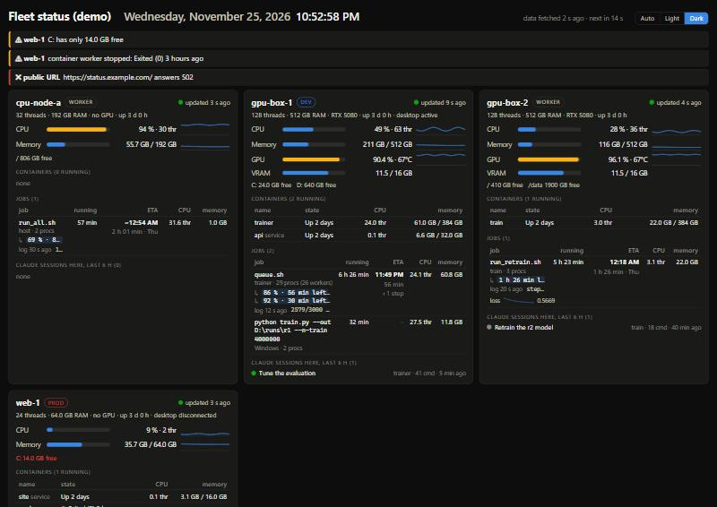

# fleet-status

One live page with every machine you run long jobs on: CPU, memory, GPU, disks, containers, and
the jobs running on each, with their logs, loss curves and an **ETA**. Made for a handful of
workstations and servers that run training runs, experiment queues and batch scripts, often started
by people or by coding agents (it can show which Claude Code session started a job).



- **No agents to install.** The server runs on one machine and polls the others over SSH every 15 s
  with a read-only probe script (PowerShell on Windows, Python 3 on Linux). It starts, stops and
  changes nothing.
- **No dependencies.** Python 3.9+ standard library and one HTML file.
- **Windows and Linux**, with jobs inside WSL containers (`wslc`), Docker or Podman, or directly on
  the host.

Try it with made-up data:

```
python server.py --demo
```

then open http://127.0.0.1:8540/.

## What it shows

- **A card for each machine**, sorted by name: CPU, memory, GPU and VRAM with 30-minute sparklines,
  free space per disk, uptime, containers (CPU, memory against their limit), and its jobs.
- **Jobs.** Inside a container, or on a Linux host, a job is one process session: what
  `nohup setsid ...` or a shell script starts. Each job shows its leading command, run time, CPU in
  threads (from the change in CPU time between polls), memory, process and worker counts, the steps
  it is running now (`↳`), the last line of its log files, and its loss curve when the logs print one
  (`loss 0.58`, `val_loss=...`). On Windows, Python and build processes are shown as jobs.
- **ETA** for each job and step: finish time and time left. Hover it to see how it was worked out.
  The sources, best first:
  1. the time left a log prints: `0.21 h left`, `ETA 1:02:03`, tqdm's `<02:30`;
  2. `done/total` in the latest progress line (`350/400`, `1,094,400 of 2,000,000`,
     `[253600/400000]`, `epoch 3/10`), with the rate seen over the last 30 minutes of polls, else the
     rate the log prints (`1,202 a second`, `500 items an hour`, `7.3 s a sample`, `3.0it/s`), else
     the pace since the step started;
  3. a time budget in the command: `--hours 6`, `--minutes 90`.

  For a shell script, the probe also reads the script itself. Items still to come in a
  `for x in a b c` loop count at the length of the current item (shown with `~`), later commands
  with `--hours` add their budget, and other later commands show as `+N steps`. `≥` means a step
  running beside it shows no progress; `due now` means it should have finished by its rate (its log
  is behind); `–` means no progress line and no time limit.
- **Alerts**: a machine not reachable, a disk under 20 GB free, a container that stopped in the
  last day, a container near its memory limit, memory above 92 %, a job whose logs have been silent
  for 30 minutes, a loss that is NaN or has not moved in 5 values, a URL that answered before and
  now fails, and (for `wslc`) nobody signed in on the desktop.
- **Queued work**: the script queues running in containers, plus any folders of queued items you
  configure, each with an ETA.
- **Optional panels**, each turned on by the config: experiment results (chart over time with
  intervals, sortable table), counters (for example an API budget), public URLs checked every
  minute, Windows scheduled tasks, and Claude Code sessions (which machines each session's shell
  commands reached in the last hours, and which session started a job).

## Set up

1. Copy `config.example.json` to `config.json` and list your machines. `config.json` is in
   `.gitignore`: it is yours alone.

   ```json
   {"machines": [
     {"name": "gpu-box-1", "role": "dev", "os": "windows", "runtime": "wslc"},
     {"name": "gpu-box-2", "ssh": "gpu-box-2", "os": "linux", "runtime": "docker"}
   ]}
   ```

   - `name`: shown on the page (and matched in Claude Code commands).
   - `ssh`: the host to `ssh` to (an alias from `~/.ssh/config` is best); leave it out for the
     machine the server runs on.
   - `os`: `windows` or `linux`.
   - `runtime`: `wslc`, `docker`, `podman` or `none`. For `wslc`, `wslc_session` defaults to
     `wslc-cli-<user>`.
   - `role`: any word; `dev`, `worker` and `prod` get their own badge colors.

2. Make sure the server's machine can reach each one by **key-based SSH with no prompt**
   (`ssh -o BatchMode=yes <host> echo ok`). A Windows machine needs the OpenSSH server; a Linux
   machine needs `python3`. Container jobs are read with `ps` and `python3` inside each container
   (logs and ETAs need `python3` there; without it you still get the processes).

3. Run it:

   ```
   python server.py              # reads config.json next to it
   python server.py --config other.json --port 8600
   ```

   On Windows, `register_task.ps1` starts it at sign-in (`-Remove` to undo).

### Optional panels

All are in `config.example.json`; leave one out to hide it.

- `queues`: folders of JSON files, one item a file (`glob` for waiting items, `held_glob` for held
  ones), with `fields` naming the keys for name, detail, machine and what it waits for. For an ETA,
  set `duration_minutes`, or `"duration_from": "experiments"` to use the median length of past
  experiments, and `parallel` for how many run at once.
- `experiments`: a glob of result files (one JSON file an experiment) with `fields` for name, title,
  start and end times and verdict, and `series` to plot: each a dotted path to a value and,
  optionally, its interval (`ci`) and verdict. `markers` draw dashed lines at given times.
- `counters`: a value and an optional limit read from a JSON file.
- `urls`: URLs to check every minute. `cloudflared: {"ssh": "<host>"}` adds every host name of a
  Cloudflare tunnel, read from cloudflared's metrics server on that machine.
- `scheduled_tasks`: Windows tasks in the root folder that are not Microsoft's; `exclude` is a
  regular expression of task names to leave out.
- `claude_sessions`: reads Claude Code transcripts (`~/.claude/projects/*/*.jsonl`) on the server's
  machine.

Tuning: `windows_job_exe`, `skip_cmd`, `linux_job_cmd` and `service_noise` are regular expressions
for what counts as a job; `stale_log_minutes`, `low_disk_gb`, `period_seconds` and
`history_minutes` set the alerts and the polling.

## Security

The page has **no sign-in** and shows command lines, paths and host names. The server listens on
127.0.0.1 only. To see it from other machines, put it behind something that checks who you are:
for example [Tailscale Serve](https://tailscale.com/kb/1312/serve) (`tailscale serve --bg 8540`,
your tailnet only) or a tunnel with an access policy. Do not open the port to the internet.

## How it works

`server.py` polls each machine in its own thread by piping `probe.ps1` or `probe_linux.py` (with
`logscan.py` put in) to `powershell -Command -` or `python3 -`, locally or over `ssh`. Edits to the
probes apply at the next poll. A probe takes 2 to 8 s. `logscan.py` runs inside each container (and
on a Linux host) and lists the files processes write as their stdout/stderr or open for writing
with a log-like name, with their last line, loss values and latest progress line, plus the text of
running shell scripts. `jobs.py` turns a probe into jobs and ETAs; `plugins.py` holds the optional
panels; `index.html` is the page.

## Contributing

Tests: `python -m unittest discover -s tests`.

Before committing, turn on the hook that keeps private details out:

```
git config core.hooksPath tools/hooks
```

It runs `tools/check_private.py --staged`, which refuses a commit containing any regular
expression from your own blocklist (kept outside the repo, at `~/.config/fleet-status/blocklist.txt`
or `$FLEET_STATUS_BLOCKLIST`: your host names, user name, domains, project names) or a secret-looking
value (tokens, keys, Tailscale addresses). `--history` checks every commit.

## License

MIT
